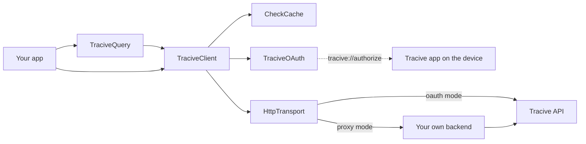

# @tracive/sdk-react-native

Check a phone number, e-mail address, bank account, IBAN, crypto address or social handle against
Tracive's community scam reports, from a React Native or Expo app.

The public surface mirrors the Tracive SDKs for Kotlin Multiplatform, Flutter and Swift 1:1, and
all four share a byte-identical test fixture for the lookup-key grammar so they cannot drift apart.

Apache-2.0.

---

## Read this first

Four things are true about this package, and finding out about any of them late reads as "the SDK
is broken":

1. **The Tracive API is not live yet.** This package is the client half of a contract. It is
   complete, tested and installable, and there is no production endpoint to point it at today.
   Everything below describes the shape of the integration, not a service you can call this
   afternoon.

2. **There is no API key. In either mode, anywhere in the surface.** Authorization is OAuth 2.0
   with PKCE (S256 only), performed by the Tracive app already installed on the user's device. If
   you are looking for where to paste a secret, there isn't one — and a `client_secret` must never
   ship inside a mobile app, which is what the `CONFIDENTIAL` client type exists for.

3. **Authorization cannot complete in Expo Go.** Two independent reasons: `LSApplicationQueriesSchemes`
   cannot be tested in Expo Go, so the iOS app-presence probe answers `false` regardless of the
   truth; and Expo Go's redirect URI is an `exp://` URL, while the authorization server matches the
   registered HTTPS redirect exactly and rejects custom schemes. **A development build or a bare
   React Native app is required for the authorization round-trip.** Query building, the models, the
   record-key guard and the cache all work fine in Expo Go for prototyping.

4. **Every check is billed, including one that finds nothing.** A miss costs the same as a hit.
   That single fact explains most of this SDK's design: the query builders reject a malformed
   identifier locally instead of sending it; a check is never retried without an idempotency key;
   and the cache is a billing feature before it is a performance feature.

---

## Install

```sh
npm install @tracive/sdk-react-native
```

That is the whole install. The package is pure TypeScript and **ships no native code at all** — no
`android/`, no `ios/`, no podspec, no autolinking, no TurboModule. It is architecture-agnostic by
construction, so the Fabric-versus-bridge question never comes up, and it does not pin your React
Native version to ours.

Its only two runtime dependencies are [`@noble/hashes`](https://github.com/paulmillr/noble-hashes)
and [`@noble/ciphers`](https://github.com/paulmillr/noble-ciphers): pure JavaScript, MIT, and
together they pull in **zero** transitive packages. See [SECURITY.md](SECURITY.md) for their audit
provenance, stated precisely.

### You will need a random source

React Native ships no WebCrypto, and PKCE and cache encryption both need a real one. The SDK
**throws a named error rather than falling back to `Math.random()`** — a deterministic PRNG here
produces predictable PKCE verifiers while every test still passes, which is exactly the kind of
failure that stays invisible until it matters.

```sh
# Expo
npx expo install expo-standard-web-crypto   # or expo-crypto

# Bare React Native
npm i react-native-get-random-values
```

and, for bare React Native, at the very top of your entry file:

```ts
import 'react-native-get-random-values';
```

### Then install a persistent cache. This is a bill, not a performance tip.

Out of the box the SDK caches in memory, which means every process restart throws away results you
have already paid for. **A cache hit costs zero credits; every uncached repeat is a charge.** A
HIGH-tier verdict is cached for 30 days — losing it to an app restart is 30 days of re-billing the
same lookup.

```sh
# Expo
npx expo install expo-sqlite expo-secure-store

# Bare React Native
npm i @op-engineering/op-sqlite react-native-keychain
```

```ts
import { openExpoCheckCache } from '@tracive/sdk-react-native/expo';
// or: import { openBareCheckCache } from '@tracive/sdk-react-native/bare';

const cache = await openExpoCheckCache();
```

Neither of these ever throws. A cache that cannot open degrades to a cold cache with
`cache.lastStoreError` populated, never to a broken SDK. See [docs/caching.md](docs/caching.md),
including how to bring your own store if you would rather not add a SQL driver at all.

### And pass the two auth stores in. Without them a sign-in can be lost outright.

`TokenStore` and `PendingAuthorizationStore` both default to in-memory, and neither default is right
for a shipping app:

- **The grant does not outlive the app.** Every restart loses it and the user authorizes again.
- **An authorization interrupted by process death cannot be completed.** Consent happens in the
  Tracive app, so your process is backgrounded throughout — on Android, exactly when the OS reclaims
  it. The pending record holding the PKCE verifier dies with it, and when the redirect comes back
  `handleCallback` can only answer `failed` / `stateMismatch`, "No authorization is in progress".
  Nothing throws and no diagnostic fires: that redirect is indistinguishable from one no
  `authorize()` preceded. The user signed in and you have nothing to show for it.

The secure store you already installed for the cache above is all either one needs:

```ts
import { TraciveClient, TraciveMode, TraciveOAuth } from '@tracive/sdk-react-native';
import {
  expoSecurePendingAuthorizationStore,
  expoSecureTokenStore,
} from '@tracive/sdk-react-native/expo';

// `config` is your OAuthConfiguration — clientId, redirectUri and scopes. See "Use it" below.
const client = new TraciveClient({
  mode: TraciveMode.oauth(config),
  cache,
  oauth: new TraciveOAuth({
    mode: config,
    tokenStore: expoSecureTokenStore(),
    pendingStore: expoSecurePendingAuthorizationStore(),
  }),
});
```

Bare React Native is the same shape with `keychainTokenStore()` and
`keychainPendingAuthorizationStore()` from `@tracive/sdk-react-native/bare`. Neither store is the
default because this package depends on no storage library — both adapters sit behind optional peer
dependencies — and picking one at runtime would turn a missing dependency into a crash report nobody
can read. [docs/oauth.md](docs/oauth.md) has the full wiring, including what a hand-built
`TraciveOAuth` does **not** inherit from the client.

---

## Configure the host app, then check it

Everything the host app must declare names **your** domain, which a library cannot know. Rather than
leaving you to discover a missing declaration through a conversion rate that quietly sits at zero,
this SDK ships a build-time checker:

```sh
npx tracive-doctor --redirect-uri https://your.app/oauth/callback
```

It reads your Android manifest (preferring the merged one), your `Info.plist`, your entitlements
file and your `app.json`, prints exactly what is missing along with the block to paste, and exits 1
on any hard finding. **Expo prebuild users get all of it written automatically** by the config
plugin:

```json
{
  "expo": {
    "plugins": [
      [
        "@tracive/sdk-react-native/app.plugin.js",
        { "redirectUri": "https://your.app/oauth/callback" }
      ]
    ]
  }
}
```

The full manual setup is in [docs/integration.md](docs/integration.md).

---

## How it works

You build a `TraciveQuery`, which folds your user's identifier into the exact key the server indexes
and throws if it cannot produce one. `TraciveClient` then answers from the `CheckCache` when it can,
and goes to the network when it cannot. Authorization is a separate concern owned by `TraciveOAuth`:
it hands the user to the Tracive app already installed on their device and receives an OAuth code
back through your own App Link. In phase 2 the same client can instead be pointed at your own
backend, and your backend holds the credentials.



**[docs/architecture.md](docs/architecture.md)** has the full diagram set: the PKCE authorization
round trip, the token refresh latch, the check request path with its retry loop and caching rules,
how each identifier type is folded, and the redaction layer that keeps credentials out of anything
this SDK serialises.

---

## Use it

```ts
import {
  TraciveClient,
  TraciveMode,
  TraciveQuery,
  TraciveScopes,
  isTraciveQueryError,
  isTraciveError,
} from '@tracive/sdk-react-native';

const client = new TraciveClient({
  mode: TraciveMode.oauth({
    clientId: 'your-client-id',
    redirectUri: 'https://your.app/oauth/callback',
    scopes: [TraciveScopes.scammerCheck],
  }),
  cache,
});

// Route incoming links into the SDK once, at app start.
const stop = client.startLinkListener();
client.onAuthResult((result) => {
  if (result.type === 'authorized') {
    /* ... */
  }
  if (result.type === 'appNotInstalled') {
    // The SDK has already opened the install page. Say "install Tracive, then try again" —
    // there is no deferred resume, so the user comes back here and calls authorize() again.
  }
});

// authorize() resolves to null when the flow was launched: the outcome arrives at the listener
// above, because the app-to-app hop can outlive this process.
await client.authorize();
```

**Ask for scopes through `TraciveScopes`, not by retyping the strings.** A mistyped scope is not a
narrower grant: the authorization server refuses the entire consent request, so the integration
cannot authorize at all. The three constants — `scammerCheck`, `creditsRead`, `profileRead` — are in
[docs/oauth.md](docs/oauth.md), along with the `TraciveScope` union for anyone who would rather
write the literal and have the compiler check it.

```ts
try {
  const query = TraciveQuery.phone('+6281234567891');
  const result = await client.checkScammer(query);

  console.log(result.riskTier); // 'HIGH' | 'ELEVATED' | 'CAUTION' | 'NONE'
  console.log(result.found, result.reportTotal, result.credibleReports);
  console.log(result.origin); // 'SERVER' on a fresh check, 'CACHE' on a replay
  if (result.disclaimer) {
    // Legal text. Surface it in any UI built on this result.
  }
} catch (error) {
  if (isTraciveQueryError(error)) {
    // The identifier could not produce a key the server can match, so nothing was sent and
    // nothing was billed. error.reason says which rule rejected it.
  } else if (isTraciveError(error)) {
    // A real answer from the server, or a transport failure. error.kind says which.
  }
}
```

### The five identifier types

```ts
TraciveQuery.phone('+6281234567891'); // E.164 only — see below
TraciveQuery.email('Budi@Gmail.com');
TraciveQuery.bankAccount({ countryAlpha3: 'IDN', bankCode: 'BCA', account: '3242-4242-422' });
TraciveQuery.iban('DE89 3704 0044 0532 0130 00');
TraciveQuery.crypto({ chain: 'ETH', address: '0x52908400098527886E0F7030069857D2E4169EE7' });
TraciveQuery.username({ platform: 'INSTAGRAM', handle: '@ScammerX' });
```

Each factory folds its input into the exact key the server indexes — stripping formatting from a
phone number, uppercasing an IBAN, lowercasing an EVM address but _not_ a base58 one — and **throws
rather than returning a query that cannot match**. Multi-field factories take an object bag so two
strings of the same type cannot be silently transposed at the call site.

**Phone numbers must be E.164.** The server cannot up-convert a local number, so `081234567891`
would become a different entity, miss, and still be billed. `TraciveQuery.phone` rejects it.

**An e-mail must contain an `@`.** The server applies no shape validation, so `budi` is a perfectly
legal key: it would be looked up, miss, and still be billed. `TraciveQuery.email` rejects it with
reason `not_an_email`. The check is deliberately nothing more than that — a stricter address grammar
would start refusing addresses the server would have matched, and a refused lookup is an answer you
never get.

**There is no `domain()` builder**, and this is deliberate rather than an omission. The Tracive API
indexes exactly five identifier types, so a domain key would match nothing and the miss would still
cost a credit. Domain checking is planned for a future release built on similarity search, which
does not fit exact-match keys; adding it then is not a breaking change.

### Where the result comes from

```ts
await client.checkScammer(query, { source: 'CACHE_FIRST' }); // default
```

| `source`       | Behaviour                                                                                                                                                                               |
| -------------- | --------------------------------------------------------------------------------------------------------------------------------------------------------------------------------------- |
| `CACHE_FIRST`  | A fresh cache hit wins; otherwise fetch and store. A cache _fault_ is treated as a miss.                                                                                                |
| `SERVER`       | Always fetch. The response still refreshes the cache.                                                                                                                                   |
| `SERVER_FIRST` | Fetch; fall back to the cache only when the failure was transport-shaped. A 402 or a 403 is a real answer about your account and is never masked by a cached verdict.                   |
| `CACHE`        | Cache only. A miss throws `cacheMiss`; a storage _fault_ surfaces as itself, because answering "no reports" when the truth is "the disk is broken" would be a fabricated clean verdict. |

### `detail: 'full'` never touches the cache

The table above describes `detail: 'minimal'`, which is the default and the **only** detail level
that is cached. A stored row has no `topChronologies` and no `comments` — they are dropped on the
way in, because free-text reports about third parties are not a partner app's data to hold — so
serving one to a caller who asked for `full` would return both as `undefined`, which reads exactly
like "the server answered in full and there is nothing on file". A wrong fraud answer, not a stale
one, and a silent one.

So for `detail: 'full'` the cache is skipped in all four places: `CACHE_FIRST` goes straight to the
network, `CACHE` throws `cacheMiss` without reading anything, the response is not stored, and
`SERVER_FIRST` surfaces the network error instead of degrading to a cached row. Two things follow
for your bill and your offline behaviour: `full` then `minimal` on one identifier costs two credits
rather than one, and a full-detail check with no network fails rather than returning a partial
answer that looks complete. The Kotlin, Swift and Flutter SDKs behave identically. See
[docs/caching.md](docs/caching.md) for the write side of the rule, which is about `locale`.

### Retrying costs money, so you have to ask

```ts
await client.checkScammer(query, { idempotencyKey: someUniqueId });
```

**Without an idempotency key the SDK will not retry a 5xx, a 429 or a timeout.** It cannot tell
whether the first attempt was already charged, and a blind retry risks a double charge. Pass a key
if you intend to retry; the same key is reused on every attempt, which is what lets the server
deduplicate. `GET /credits` and `GET /profile` have no side effects and are always retryable.

### Do not poll `credits()`

Handle the 402 from `checkScammer` instead. It saves a round trip per transaction, and a balance
read a moment earlier can be stale by the time the check lands anyway.

---

## Everything is a port

Every capability that touches the outside world is an interface you can replace: `HttpTransport`,
`TraciveClock`, `TraciveRandom`, `TokenStore`, `PendingAuthorizationStore`, `CheckCache`,
`CheckCacheStore`, `CacheKeyStore`, `CacheCipher`, `AppPresenceProbe`, `AuthorizeLauncher`. That is
what makes the whole SDK testable without a socket, a device or a browser — every test in this
repository runs against injected fakes — and it is what keeps any single upstream dependency from
becoming load-bearing.

Nothing fails silently. Pass `onDiagnostic` to receive the conditions that are not worth throwing
over but that you must be able to see in your own telemetry.

---

## Documentation

- [docs/architecture.md](docs/architecture.md) — diagrams of the whole SDK, end to end
- [docs/integration.md](docs/integration.md) — host app configuration, platform by platform
- [docs/oauth.md](docs/oauth.md) — the authorization flow and why it is shaped this way
- [docs/caching.md](docs/caching.md) — TTLs, encryption, and bringing your own store
- [docs/proxy-contract.md](docs/proxy-contract.md) — the phase 2 gateway mode
- [docs/OPEN_QUESTIONS.md](docs/OPEN_QUESTIONS.md) — risks carried forward, stated plainly
- [SECURITY.md](SECURITY.md) — the cryptography, including what is _not_ independently audited
- [CONTRIBUTING.md](CONTRIBUTING.md) — including the rules for what may not appear in this repo

## Requirements

- React Native >= 0.76 (see [docs/OPEN_QUESTIONS.md](docs/OPEN_QUESTIONS.md) — this floor is
  reasoned, not yet proven by a build)
- Node >= 20.19 for the tooling
- ESM only, no CommonJS build
