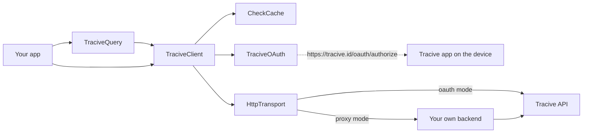

# @pleistocent/tracive-sdk-react-native

Check a phone number, e-mail address, bank account, IBAN, crypto address or social handle against
Tracive's community scam reports, from a React Native or Expo app.

The public surface mirrors the Tracive SDKs for Kotlin Multiplatform, Flutter and Swift 1:1, and
all four share a byte-identical test fixture for the lookup-key grammar so they cannot drift apart.

Apache-2.0.

---

## Read this first

Four things are true about this package, and finding out about any of them late reads as "the SDK
is broken":

1. **Sandbox and production are separate registrations.** Both environments answer —
   `https://api-sandbox.tracive.id/v1` and `https://api.tracive.id/v1`, with consent in the matching
   build of the Tracive app — and each needs a client id issued for it, with your redirect registered
   on that client. A sandbox client id is unknown to production. Build against
   `TraciveEnvironment.sandbox`; `production` is the default.

2. **There is no API key. In either mode, anywhere in the surface.** Authorization is OAuth 2.0
   with PKCE (S256 only), performed by the Tracive app already installed on the user's device. If
   you are looking for where to paste a secret, there isn't one — and a `client_secret` must never
   ship inside a mobile app, which is what the `CONFIDENTIAL` client type exists for.

3. **Authorization cannot complete in Expo Go.** Two independent reasons: `LSApplicationQueriesSchemes`
   cannot be tested in Expo Go, so the iOS app-presence probe answers `false` regardless of the
   truth; and Expo Go's redirect URI is an `exp://` URL that changes with the dev server's address,
   while the authorization server matches the registered redirect exactly. **A development build or a bare
   React Native app is required for the authorization round-trip.** `openReportForm` needs one too,
   because it runs in the SDK's native module. Query building, the models, the record-key guard and
   the cache all work fine in Expo Go for prototyping.

4. **Every check is billed, including one that finds nothing.** A miss costs the same as a hit.
   That single fact explains most of this SDK's design: the query builders reject a malformed
   identifier locally instead of sending it; a check is never retried without an idempotency key;
   and the cache is a billing feature before it is a performance feature.

---

## Install

```sh
npm install @pleistocent/tracive-sdk-react-native
```

Then rebuild the native app: **since 0.2.0 the package contains native code**, one small
TurboModule in Kotlin and Swift that only `openReportForm` uses. It autolinks (`android/` and
`TraciveSdkReactNative.podspec` at the package root), so the rebuild is the whole step: `npx expo
run:android` / `npx expo run:ios` or an EAS build for Expo, a Gradle build and `pod install` for bare
React Native. Everything else — queries, checks, the cache, authorization — is still TypeScript and
works on a JavaScript-only update; `openReportForm` on a binary built without the module answers
`failed` with `PLATFORM_FAILURE` and says to rebuild.

Its only two runtime dependencies are [`@noble/hashes`](https://github.com/paulmillr/noble-hashes)
and [`@noble/ciphers`](https://github.com/paulmillr/noble-ciphers): pure JavaScript, MIT, and
together they pull in **zero** transitive packages. See [SECURITY.md](SECURITY.md) for their audit
provenance, stated precisely.

### You will need a random source, for every call and not just for sign-in

React Native ships no WebCrypto. PKCE and cache encryption need a real one, and so does **every
`checkScammer` call**: each check carries an `Idempotency-Key`, and when you supply none the SDK
generates one, drawn from the same seam. There is no path through this SDK that does not need
randomness.

Without it, a check fails with `TraciveConfigurationError` and the code **`csprng_unavailable`** —
the same named, actionable error authorization has always raised, now on the check path too. The
SDK **throws rather than falling back to `Math.random()`**: a deterministic PRNG produces
predictable PKCE verifiers and predictable cache nonces while every test still passes, which is
exactly the kind of failure that stays invisible until it matters.

On Expo, install `expo-crypto` and pass the adapter this package builds on it, `expoRandom`, as
`random` to each of the three things that draw randomness — the same wiring as
[`example/App.tsx`](example/App.tsx):

```sh
npx expo install expo-crypto
```

```ts
import { expoRandom, openExpoCheckCache } from '@pleistocent/tracive-sdk-react-native/expo';

const cache = await openExpoCheckCache({ random: expoRandom });
const oauth = new TraciveOAuth({ mode: config, /* … */ random: expoRandom });
const client = new TraciveClient({
  mode: TraciveMode.oauth(config),
  cache,
  oauth,
  random: expoRandom,
});
```

Installing a package is not enough on its own. By default the SDK reads `globalThis.crypto`, and
neither `expo-crypto` nor `expo-standard-web-crypto` defines it on import — the second only does once
you call its `polyfillWebCrypto()`.

On bare React Native, install the polyfill and import it at the very top of your entry file; that
one does define the global:

```sh
npm i react-native-get-random-values
```

```ts
import 'react-native-get-random-values';
```

Any other runtime can pass its own implementation of the `TraciveRandom` port, which
`TraciveClient` and `TraciveOAuth` both accept as `random`:

```ts
const client = new TraciveClient({ mode, random: myRandom });
```

That injection point is the supported answer for a runtime where a polyfill is not an option. It is
not an answer for a runtime where one is: whatever you pass has to be cryptographically secure, and
nothing here can check that for you.

### Then install a persistent cache. This is a bill, not a performance tip.

Out of the box the SDK caches in memory, which means every process restart throws away results you
have already paid for. **A cache hit costs zero credits; every uncached repeat is a charge.** A
HIGH-tier verdict is cached for 30 days — losing it to an app restart is 30 days of re-billing the
same lookup.

```sh
# Expo
npx expo install expo-sqlite expo-secure-store

# Bare React Native
npm i @op-engineering/op-sqlite react-native-keychain
```

```ts
import { openExpoCheckCache } from '@pleistocent/tracive-sdk-react-native/expo';
// or: import { openBareCheckCache } from '@pleistocent/tracive-sdk-react-native/bare';

const cache = await openExpoCheckCache();
```

Neither of these ever throws. A cache that cannot open degrades to a cold cache with
`cache.lastStoreError` populated, never to a broken SDK. See [docs/caching.md](docs/caching.md),
including how to bring your own store if you would rather not add a SQL driver at all.

### And pass the two auth stores in. Without them a sign-in can be lost outright.

`TokenStore` and `PendingAuthorizationStore` both default to in-memory, and neither default is right
for a shipping app:

- **The grant does not outlive the app.** Every restart loses it and the user authorizes again.
- **An authorization interrupted by process death cannot be completed.** Consent happens in the
  Tracive app, so your process is backgrounded throughout — on Android, exactly when the OS reclaims
  it. The pending record holding the PKCE verifier dies with it, and when the redirect comes back
  `handleCallback` can only answer `failed` / `stateMismatch`, "No authorization is in progress".
  Nothing throws and no diagnostic fires: that redirect is indistinguishable from one no
  `authorize()` preceded. The user signed in and you have nothing to show for it.

The secure store you already installed for the cache above is all either one needs:

```ts
import { TraciveClient, TraciveMode, TraciveOAuth } from '@pleistocent/tracive-sdk-react-native';
import {
  expoRandom,
  expoSecurePendingAuthorizationStore,
  expoSecureTokenStore,
} from '@pleistocent/tracive-sdk-react-native/expo';

// `config` is your OAuthConfiguration — clientId, redirectUri, partnerUserId and scopes. See
// "Use it" below; every value you have to supply there is marked `TODO(partner)`.
const client = new TraciveClient({
  mode: TraciveMode.oauth(config),
  cache,
  random: expoRandom,
  oauth: new TraciveOAuth({
    mode: config,
    tokenStore: expoSecureTokenStore(),
    pendingStore: expoSecurePendingAuthorizationStore(),
    random: expoRandom,
  }),
});
```

Bare React Native is the same shape with `keychainTokenStore()` and
`keychainPendingAuthorizationStore()` from `@pleistocent/tracive-sdk-react-native/bare`. Neither store is the
default because this package depends on no storage library — both adapters sit behind optional peer
dependencies — and picking one at runtime would turn a missing dependency into a crash report nobody
can read. [docs/oauth.md](docs/oauth.md) has the full wiring, including what a hand-built
`TraciveOAuth` does **not** inherit from the client.

---

## Configure the host app, then check it

Everything the host app must declare names **your** domain, which a library cannot know. Rather than
leaving you to discover a missing declaration through a conversion rate that quietly sits at zero,
this SDK ships a build-time checker:

```sh
npx tracive-doctor --redirect-uri https://your.app/oauth/callback
```

It reads your Android manifest (preferring the merged one), your `Info.plist`, your entitlements
file and your `app.json`, prints exactly what is missing along with the block to paste, and exits 1
on any hard finding. **Expo prebuild users get all of it written automatically** by the config
plugin:

```json
{
  "expo": {
    "plugins": [
      [
        "@pleistocent/tracive-sdk-react-native/app.plugin.js",
        { "redirectUri": "https://your.app/oauth/callback" }
      ]
    ]
  }
}
```

The full manual setup is in [docs/integration.md](docs/integration.md).

---

## How it works

You build a `TraciveQuery`, which folds your user's identifier into the exact key the server indexes
and throws if it cannot produce one. `TraciveClient` then answers from the `CheckCache` when it can,
and goes to the network when it cannot. Authorization is a separate concern owned by `TraciveOAuth`:
it hands the user to the Tracive app already installed on their device and receives an OAuth code
back through your own App Link. In phase 2 the same client can instead be pointed at your own
backend, and your backend holds the credentials.



**[docs/architecture.md](docs/architecture.md)** has the full diagram set: the PKCE authorization
round trip, the token refresh latch, the check request path with its retry loop and caching rules,
how each identifier type is folded, and the redaction layer that keeps credentials out of anything
this SDK serialises.

---

## Use it

```ts
import {
  TraciveClient,
  TraciveMode,
  TraciveQuery,
  TraciveScopes,
  isTraciveQueryError,
  isTraciveError,
} from '@pleistocent/tracive-sdk-react-native';

const client = new TraciveClient({
  mode: TraciveMode.oauth({
    // TODO(partner): the client id you were issued at registration.
    clientId: 'your-client-id',
    // TODO(partner): an App Link / Universal Link on a host you own. `npx tracive-doctor` below
    // checks that the host app actually declares it.
    redirectUri: 'https://your.app/oauth/callback',
    // TODO(partner): your own stable, opaque id for this user — required and never blank, and
    // never a raw phone number or email.
    partnerUserId: 'your-user-id',
    // TODO(partner): the narrowest set your integration needs.
    scopes: [TraciveScopes.scammerCheck],
  }),
  cache,
});

// Route incoming links into the SDK once, at app start.
const stop = client.startLinkListener();
client.onAuthResult((result) => {
  if (result.type === 'authorized') {
    /* ... */
  }
  if (result.type === 'appNotInstalled') {
    // The SDK has already opened the install page. Say "install Tracive, then try again" —
    // there is no deferred resume, so the user comes back here and calls authorize() again.
  }
});

// authorize() resolves to null when the flow was launched: the outcome arrives at the listener
// above, because the app-to-app hop can outlive this process.
await client.authorize();
```

**Ask for scopes through `TraciveScopes`, not by retyping the strings.** A mistyped scope is not a
narrower grant: the authorization server refuses the entire consent request, so the integration
cannot authorize at all. The three constants — `scammerCheck`, `creditsRead`, `profileRead` — are in
[docs/oauth.md](docs/oauth.md), along with the `TraciveScope` union for anyone who would rather
write the literal and have the compiler check it.

```ts
try {
  const query = TraciveQuery.phone('+6281234567891');
  const result = await client.checkScammer(query);

  console.log(result.riskTier); // 'HIGH' | 'ELEVATED' | 'CAUTION' | 'NONE'
  console.log(result.found, result.reportTotal, result.credibleReports);
  console.log(result.origin); // 'SERVER' on a fresh check, 'CACHE' on a replay
  if (result.disclaimer) {
    // Legal text. Surface it in any UI built on this result.
  }
} catch (error) {
  if (isTraciveQueryError(error)) {
    // The identifier could not produce a key the server can match, so nothing was sent and
    // nothing was billed. error.reason says which rule rejected it.
  } else if (isTraciveError(error)) {
    // A real answer from the server, or a transport failure. error.kind says which.
  }
}
```

### Errors, and one that repairs itself

`error.kind` says which case you are in. The two worth handling by name are `insufficientCredits`
(402 — offer a top-up, do not pre-check with `credits()`) and `invalidToken`, which means no usable
grant is stored: either nobody has authorized yet, or the stored record has neither an access token
nor a refresh token left. Nothing reaches the server on that path, so nothing is billed. Send the
user through `authorize()`.

Three more are about your contract or quota rather than your code:

| `error.kind`              | When                                                                                                                                                                                                            | What to do                                                                                             |
| ------------------------- | --------------------------------------------------------------------------------------------------------------------------------------------------------------------------------------------------------------- | ------------------------------------------------------------------------------------------------------ |
| `userCreditNotPermitted`  | 403 on a check: your contract does not let you charge the user's subscription credits                                                                                                                           | contact Tracive; retrying will not help                                                                |
| `translationNotPermitted` | 403 on a `detail: 'full'` check with a non-English `locale`: your contract withholds translation, or the user has no premium subscription                                                                       | check again without `locale` for the English result                                                    |
| `rateLimited`             | 429. When `error.isDailyQuotaExceeded` is `true`, a daily allowance is spent (the connection's daily quota, its account reads, or the sandbox org cap) and `retryAfterSeconds` points at the reset at 00:00 UTC | never retried by the SDK; wait `retryAfterSeconds`, and for the daily quota tell the user to try later |

A record that has lost only its access token is **not** that case. While the refresh token beside it
is still good, the SDK renews it with a single `POST /oauth/token` and carries on — so you may see
one unexplained refresh before the call you actually made. That state is reachable from a partial
write, an interrupted save, or a restored backup, and the alternative would be to send the user back
through consent to replace a credential that never stopped working.

### The five identifier types

```ts
TraciveQuery.phone('+6281234567891'); // E.164 only — see below
TraciveQuery.email('Budi@Gmail.com');
TraciveQuery.bankAccount({ countryAlpha3: 'IDN', bankCode: 'BCA', account: '3242-4242-422' });
TraciveQuery.iban('DE89 3704 0044 0532 0130 00');
TraciveQuery.crypto({ chain: 'ETH', address: '0x52908400098527886E0F7030069857D2E4169EE7' });
TraciveQuery.username({ platform: 'INSTAGRAM', handle: '@ScammerX' });
```

`bankAccount` also takes the bank the way your own records may already name it — the national bank
code or the BIC — in place of `bankCode`:

```ts
TraciveQuery.bankAccount({ countryAlpha3: 'IDN', bankShortCode: '014', account: '3242424242' });
TraciveQuery.bankAccount({ countryAlpha3: 'IDN', bic: 'CENAIDJA', account: '3242424242' });
```

Both are translated to Tracive's `bankCode` through a table that ships inside the SDK, offline, so
each builds exactly the key `bankCode: 'BCA'` builds and shares its cache entries. Leading zeros are
optional (`14` finds `014`), and an 11-character BIC is looked up by its first 8. A code the table
does not list for that country throws reason `unknown_bank_code` before any request, so it is never
billed.

Each factory folds its input into the exact key the server indexes — stripping formatting from a
phone number, uppercasing an IBAN, lowercasing an EVM address but _not_ a base58 one — and **throws
rather than returning a query that cannot match**. Multi-field factories take an object bag so two
strings of the same type cannot be silently transposed at the call site.

**Phone numbers must be E.164.** The server cannot up-convert a local number, so `081234567891`
would become a different entity, miss, and still be billed. `TraciveQuery.phone` rejects it.

**An e-mail must contain an `@`.** The server applies no shape validation, so `budi` is a perfectly
legal key: it would be looked up, miss, and still be billed. `TraciveQuery.email` rejects it with
reason `not_an_email`. The check is deliberately nothing more than that — a stricter address grammar
would start refusing addresses the server would have matched, and a refused lookup is an answer you
never get.

**There is no `domain()` builder**, and this is deliberate rather than an omission. The Tracive API
indexes exactly five identifier types, so a domain key would match nothing and the miss would still
cost a credit. Domain checking is planned for a future release built on similarity search, which
does not fit exact-match keys; adding it then is not a breaking change.

### Local phone formats: `normalizePhoneNumber`

`TraciveQuery.phone` takes E.164 and nothing else, so `081234567891` is refused rather than guessed
at — the SDK cannot know your dial code, and a wrong guess still costs a credit.
`normalizePhoneNumber` supplies it, so you can accept numbers the way people in each country
actually write them:

```ts
// Indonesians share numbers starting 08. Both produce PHONE_+6285718609079.
TraciveQuery.phone(normalizePhoneNumber('IDN', '0857-1860-9079'));
TraciveQuery.phone(normalizePhoneNumber('+62', '0857 1860 9079'));
```

The first argument is either an **ISO 3166-1 alpha-3** code (`IDN`, `USA` — case-insensitive) or a
dial code with or without `+` (`+62`, `62`). They are told apart by shape: letters mean alpha-3,
digits mean a dial code. Alpha-2 (`ID`) is refused, because this SDK speaks alpha-3 everywhere.

It is a plain exported function, not something hidden inside `phone()`, because you need the E.164
form for your own records, logging and outbound messaging too.

| Input                 | Country | Result                                                                   |
| --------------------- | ------- | ------------------------------------------------------------------------ |
| `0857-1860-9079`      | `IDN`   | `+6285718609079` — trunk prefix `0` dropped                              |
| `0062857 1860 9079`   | `IDN`   | `+6285718609079` — international prefix `00` dropped                     |
| `+62 857 1860 9079`   | `IDN`   | `+6285718609079` — already international, not doubled                    |
| `1 555 123 4567`      | `USA`   | `+15551234567` — NANP trunk prefix `1` dropped                           |
| `8 912 345 67 89`     | `RUS`   | `+79123456789` — Russian trunk prefix `8` dropped                        |
| `06 1234 5678`        | `ITA`   | `+390612345678` — Italy's leading `0` **kept**; it is part of the number |
| `+64 857 1860 9079`   | `IDN`   | **throws `country_conflict`** — the `+64` contradicts `IDN`              |
| `+0062 857 1860 9079` | `IDN`   | **throws `country_conflict`** — `+` and `00` do not stack                |

Those last two rows are the rules these SDKs do _not_ share with the Tracive app, and they differ
in kind. The first is safe: every input it rejects produced an unusable key in the app too. The
second is not — the app accepts `+00<dial>` and folds it correctly, so here the SDK is genuinely
stricter. `+` and `00` are alternative spellings of the same thing rather than stackable ones: what
follows `+` must be a country code, and `00` is none. The stored key is `PHONE_+<dial><number>`, and
admitting one malformed concatenation has no principled stopping point (`+000062`, `++62`).

`COUNTRIES` is a table of 245 entries with `dialCode`, `alpha2`, `alpha3` and `countryName`, and
`countryFromAlpha3('idn')` looks one up case-insensitively.

Everything else is a deliberate copy of the app's normalizer, pinned by
`phone-normalization-vectors.json` — vendored byte-identically into all four SDK repositories, like
the grammar fixture.

### Where the result comes from

```ts
await client.checkScammer(query, { source: 'CACHE_FIRST' }); // default
```

| `source`       | Behaviour                                                                                                                                                                               |
| -------------- | --------------------------------------------------------------------------------------------------------------------------------------------------------------------------------------- |
| `CACHE_FIRST`  | A fresh cache hit wins; otherwise fetch and store. A cache _fault_ is treated as a miss.                                                                                                |
| `SERVER`       | Always fetch. The response still refreshes the cache.                                                                                                                                   |
| `SERVER_FIRST` | Fetch; fall back to the cache only when the failure was transport-shaped. A 402 or a 403 is a real answer about your account and is never masked by a cached verdict.                   |
| `CACHE`        | Cache only. A miss throws `cacheMiss`; a storage _fault_ surfaces as itself, because answering "no reports" when the truth is "the disk is broken" would be a fabricated clean verdict. |

### Showing the check again on a transaction detail

A cache read answers "what does Tracive say about this account now". A transaction-detail screen asks
"what was this user shown before they sent the money" — a different question, and one the cache cannot
answer, because it keeps only the latest verdict per account and drops a clean one after an hour.
Record it against your own transaction id instead:

```ts
// Once the transfer exists and has a reference number.
await client.cache.writeTransactionCheck(result, 'TRF26090814320771');

// Weeks later. undefined = no check on file; render nothing, never "no reports found".
const shown = await client.cache.readTransactionCheck('TRF26090814320771');
if (shown !== undefined) renderSecurityCheckCard(shown);
```

Each record is a snapshot on its own 90-day retention, so a later check of the same account cannot
rewrite an older transaction's card, and one check can be recorded against several transactions — the
second transfer to an account you already checked costs nothing and still gets a card. Full rules in
[docs/caching.md](docs/caching.md#recording-what-a-transaction-was-shown).

**When to do each of those:** run the check on the confirmation screen, before the PIN — the user has
seen the payee and the amount, and can still change their mind for free — and only on a first transfer
to a given account, plus a manual "check this payee" action. Record it once per transaction, for every
transfer that had a check, including the one where the user was warned and continued anyway. Never
record when the user declined the check: no record is the truth, and an empty result rendered as "no
reports found" invents a reassurance nobody gave. And none of it may go to your own servers — the
partner terms forbid uploading Tracive results, derived values like a tier or a count included. What
may leave the device is the user's decision (`riskAccepted`, `riskAcceptedAt`), which is enough to
defend the transfer in a dispute.

### `detail: 'full'` never touches the cache

The table above describes `detail: 'minimal'`, which is the default and the **only** detail level
that is cached. A stored row has no `topChronologies` and no `comments` — they are dropped on the
way in, because free-text reports about third parties are not a partner app's data to hold — so
serving one to a caller who asked for `full` would return both as `undefined`, which reads exactly
like "the server answered in full and there is nothing on file". A wrong fraud answer, not a stale
one, and a silent one.

So for `detail: 'full'` the cache is skipped in all four places: `CACHE_FIRST` goes straight to the
network, `CACHE` throws `cacheMiss` without reading anything, the response is not stored, and
`SERVER_FIRST` surfaces the network error instead of degrading to a cached row. Two things follow
for your bill and your offline behaviour: `full` then `minimal` on one identifier costs two credits
rather than one, and a full-detail check with no network fails rather than returning a partial
answer that looks complete. The Kotlin, Swift and Flutter SDKs behave identically. See
[docs/caching.md](docs/caching.md) for the write side of the rule, which is about `locale`.

### Retrying costs money, so you have to ask

```ts
await client.checkScammer(query, { idempotencyKey: someUniqueId });
```

**Without an idempotency key the SDK will not retry a 5xx or a timeout.** It cannot tell
whether the first attempt was already charged, and a blind retry risks a double charge. Pass a key
if you intend to retry; the same key is reused on every attempt, which is what lets the server
deduplicate. `GET /credits` and `GET /profile` have no side effects and are always retryable.

**A 429 is never retried, key or no key.** It surfaces at once as `rateLimited` with
`retryAfterSeconds`, which can be as long as the time left until 00:00 UTC. Whether to wait is
your call.

The request always carries _some_ `Idempotency-Key`: when you pass none, the SDK generates a
per-call one, so that its own replay after a 401 token refresh can be collapsed server-side. That
does not give you a retry budget — only your own key does — and it is no substitute for a key
derived from your transaction if you want retries, or deduplication across processes.

Your key also keeps a check out of somebody else's in-flight one. Overlapping checks for the same
identifier are normally collapsed into a single billable request, but two carrying **different**
keys are two transactions by your own account and are sent as two. See
[docs/caching.md](docs/caching.md).

### Do not poll `credits()`

Handle the 402 from `checkScammer` instead. It saves a round trip per transaction, and a balance
read a moment earlier can be stale by the time the check lands anyway.

---

## Report a scammer

From a transaction detail screen, one call opens the Tracive app's report form with the recipient's
account, the transaction date and the receipts already filled in. The user reviews and submits it in
Tracive; the files stay on the device until then.

```ts
import { findNodeHandle } from 'react-native';
import { ReportAttachment, TraciveQuery } from '@pleistocent/tracive-sdk-react-native';

const result = await client.openReportForm(
  TraciveQuery.bankAccount({ countryAlpha3: 'IDN', bankCode: 'BCA', account: '1234567890' }),
  {
    incidentDate: '2026-11-03', // the transaction's calendar date, YYYY-MM-DD
    attachments: [
      ReportAttachment.image(screenshotBytes, 'image/png'), // Uint8Array
      ReportAttachment.pdf(receiptPdfBytes),
    ],
    anchor: findNodeHandle(reportButtonRef.current), // iOS: where the sheet points; iPad popover
  },
);

switch (result.type) {
  case 'opened': // result.attachmentsDelivered is false when an older Tracive took the account only
  case 'cancelled': // iOS: the user closed the sheet or sent the file elsewhere
  case 'installPageOpened': // Tracive is not installed; the install page is open, carrying nothing
    break;
  case 'failed':
    // result.error.code: INCIDENT_DATE_IN_FUTURE, TOO_MANY_ATTACHMENTS (max), UNSUPPORTED_TYPE,
    // CONTENT_MISMATCH or PDF_TOO_LARGE (index), PACKAGE_TOO_LARGE (max), PLATFORM_FAILURE (message)
    break;
}
```

- **No grant, no token, no network, no credit.** It works in every mode, a `CONFIDENTIAL` client and
  proxy mode included. The client's `environment` picks the Tracive build (a custom environment maps
  to production).
- **`incidentDate` is a string, `YYYY-MM-DD`**, not a `Date`: it is the day the user saw on the
  transaction, sent with no time-zone conversion. It may not be after the device's local today. A
  string that is not a real calendar date throws a `TypeError`; nothing is opened.
- **Attachments:** JPEG, PNG, WebP, HEIC, HEIF, BMP and PDF, checked against their first bytes. At
  most 5, or 10 when the query is a phone number. A PDF must be under 1 MiB; images have no cap (the
  app compresses them), but the whole package must fit in 20 MiB. Any refusal comes back as `failed`
  with the attachment's `index`, and opens nothing.
- **What the user sees.** On Android the form opens directly. On iOS an "Open in" sheet appears and
  the user taps Tracive; picking anything else, or closing the sheet, returns `cancelled`. On iPad,
  rotating the device closes the sheet too, and the call returns `cancelled` about a second later.
  A Tracive build too old for attachments gets the account only, through the `report/create` link,
  and the result says `attachmentsDelivered: false`.

### iOS: two more query schemes

`LSApplicationQueriesSchemes` needs the two report schemes next to the two app schemes. The Expo config
plugin adds them; by hand:

```xml
<key>LSApplicationQueriesSchemes</key>
<array>
    <string>tracive</string>
    <string>tracivesandbox</string>
    <string>tracive-report</string>
    <string>tracivesandbox-report</string>
</array>
```

If they are missing, nothing breaks: the SDK cannot tell that the installed Tracive accepts
attachments, so it sends the account only and returns `opened` with `attachmentsDelivered: false`.
`npx tracive-doctor` warns about it.

### Android: one provider in your merged manifest

The SDK's manifest adds a single `FileProvider` subclass, which your merged manifest will show:

```xml
<provider
    android:name="id.tracive.sdk.reactnative.TraciveReportFileProvider"
    android:authorities="${applicationId}.tracive-rn-files"
    android:exported="false"
    android:grantUriPermissions="true" />
```

It is not exported, and it serves only `cache/tracive-sdk/report/`, where the SDK writes the package
and deletes the previous one on each call. The package goes to Tracive in an explicit intent
(`setPackage`), with a read grant for that one file, so no other app can receive it. No permission
and no `<queries>` entry is added; the existing `tracive` / `tracivesandbox` scheme entries already
make the Tracive app visible.

### Testing against another Tracive build

`target` replaces the build the environment picks, for testing against a build the SDK does not know
about:

```ts
await client.openReportForm(query, {
  target: ReportFormTarget.custom({
    androidPackage: 'com.pleistocent.tracive.dev',
    iosBundleId: 'com.pleistocent.tracive.dev',
    scheme: 'tracivedev',
    reportScheme: 'tracivedev-report',
    fileExtension: 'tracivedevreport',
  }),
});
```

That build also needs `<queries><package android:name="…"/></queries>` on Android and both of its
schemes in `LSApplicationQueriesSchemes` on iOS. Leave `target` unset in a shipping app.

---

## Everything is a port

Every capability that touches the outside world is an interface you can replace: `HttpTransport`,
`TraciveClock`, `TraciveRandom`, `TokenStore`, `PendingAuthorizationStore`, `CheckCache`,
`CheckCacheStore`, `CacheKeyStore`, `CacheCipher`, `AppPresenceProbe`, `AuthorizeLauncher`,
`ReportFormLauncher`. That is
what makes the whole SDK testable without a socket, a device or a browser — every test in this
repository runs against injected fakes — and it is what keeps any single upstream dependency from
becoming load-bearing.

Nothing fails silently. Pass `onDiagnostic` to receive the conditions that are not worth throwing
over but that you must be able to see in your own telemetry.

---

## Documentation

- [docs/architecture.md](docs/architecture.md) — diagrams of the whole SDK, end to end
- [docs/integration.md](docs/integration.md) — host app configuration, platform by platform
- [docs/oauth.md](docs/oauth.md) — the authorization flow and why it is shaped this way
- [docs/caching.md](docs/caching.md) — TTLs, encryption, and bringing your own store
- [docs/proxy-contract.md](docs/proxy-contract.md) — the phase 2 gateway mode
- [docs/OPEN_QUESTIONS.md](docs/OPEN_QUESTIONS.md) — risks carried forward, stated plainly
- [SECURITY.md](SECURITY.md) — the cryptography, including what is _not_ independently audited
- [CONTRIBUTING.md](CONTRIBUTING.md) — including the rules for what may not appear in this repo

## Requirements

- React Native >= 0.76 (see [docs/OPEN_QUESTIONS.md](docs/OPEN_QUESTIONS.md) — this floor is
  reasoned, not yet proven by a build)
- A native rebuild after installing or upgrading: `openReportForm` is a TurboModule. It has been
  built on the New Architecture only (React Native 0.83); the legacy-architecture registration is
  in the sources but has not been built
- Node >= 20.19 for the tooling
- ESM only, no CommonJS build
