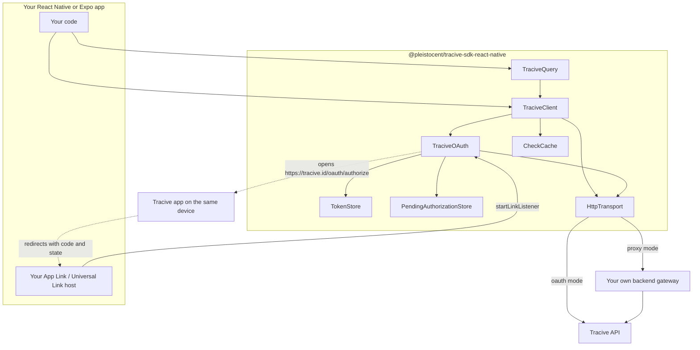
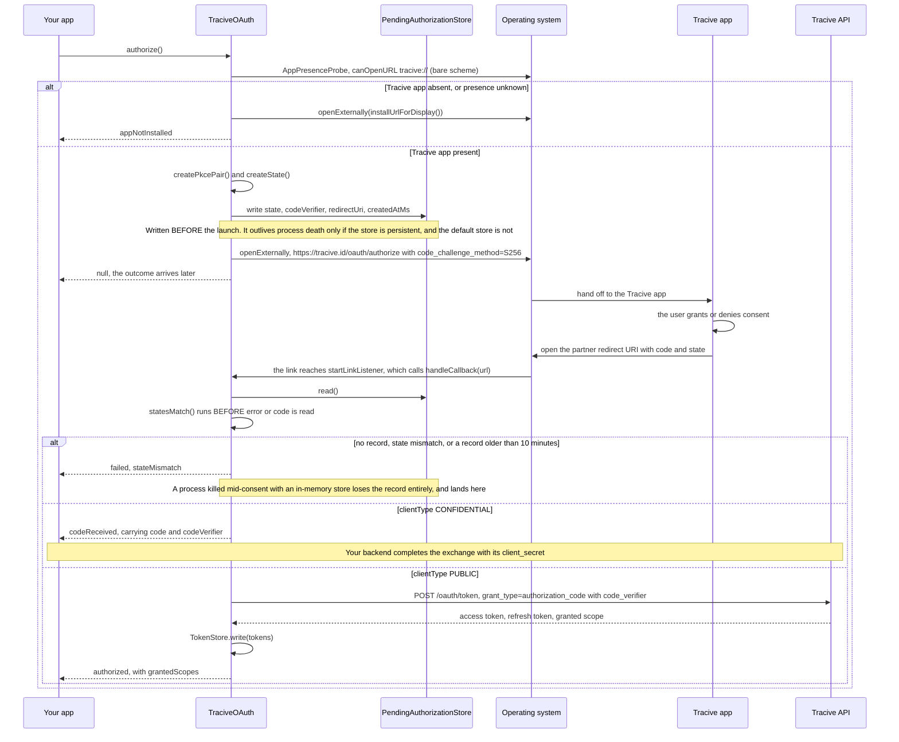
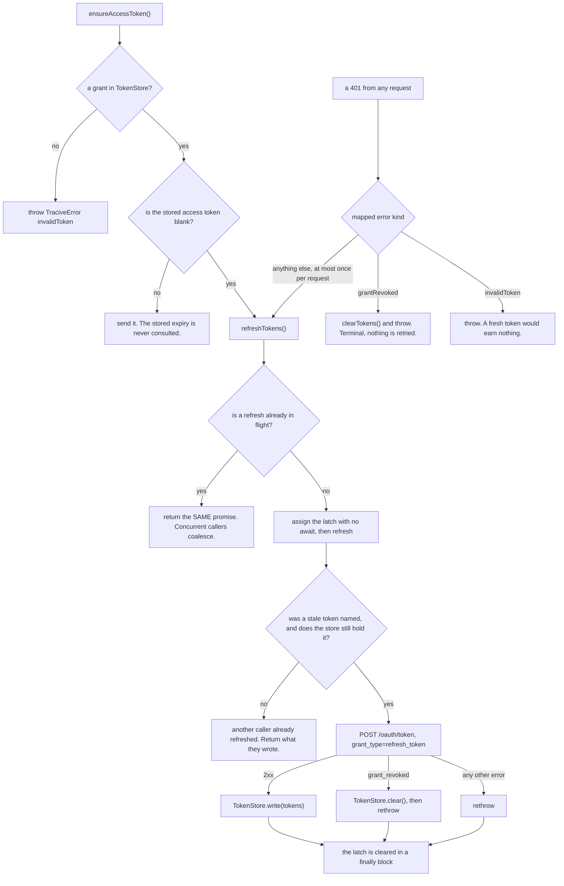
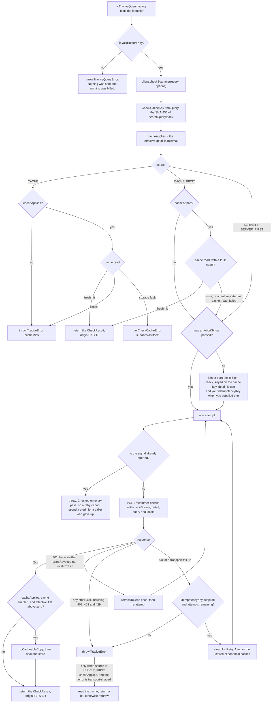
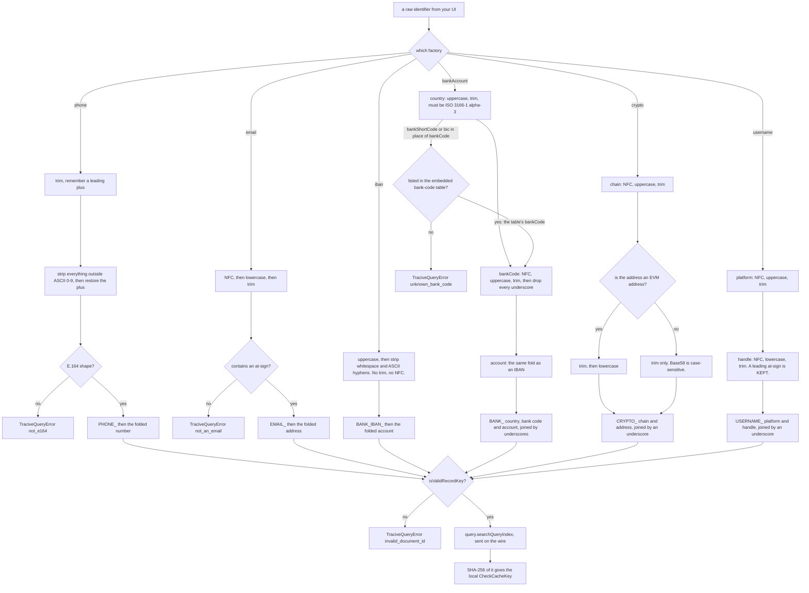
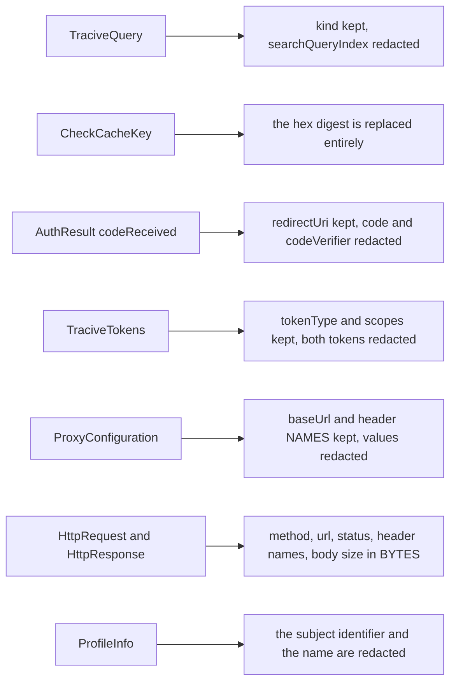

# Architecture

Diagrams for a developer who has never seen this SDK. Every arrow here is derived from the source
in `src/`; where a behaviour is a documented risk rather than a settled fact, it is marked and
linked to [OPEN_QUESTIONS.md](OPEN_QUESTIONS.md).

Two facts frame everything below, and both are load-bearing rather than decorative:

- **The wire shape is the agreed contract, not yet reconciled against the live API.** Endpoint
  paths, request fields and response fields follow the contract. See item 9 of
  [OPEN_QUESTIONS.md](OPEN_QUESTIONS.md).
- **Every check is billed, including one that finds nothing.** That is why the query builders reject
  locally, why the cache exists, why overlapping checks are collapsed, and why a check is never
  retried without an idempotency key.

The same five diagrams appear in the Tracive SDKs for Kotlin Multiplatform, Flutter and Swift. The
concepts line up; the type and method names are this package's own.

---

## A. Where the SDK sits

The package is pure TypeScript and ships no native code. Everything that touches the outside world
— the network, the clock, randomness, storage, the OS link surface — is an interface you can
replace, which is why the whole SDK is testable without a socket, a device or a browser.

There are two modes. In `TraciveMode.oauth` the SDK holds a user's own grant and calls the Tracive
API directly. In `TraciveMode.proxy` your backend holds the credentials and the SDK calls your
gateway instead; `client.oauth` is then `undefined` and the authorization methods throw. Proxy mode
is phase 2 and is not available yet — it exists in the surface now so that enabling it later is not
a breaking change. See [proxy-contract.md](proxy-contract.md).

The replaceable ports, in full: `HttpTransport`, `TraciveClock`, `TraciveRandom`, `TokenStore`,
`PendingAuthorizationStore`, `CheckCache`, `CheckCacheStore`, `CacheKeyStore`, `CacheCipher`,
`AppPresenceProbe` and `AuthorizeLauncher`.

---

## B. Authorization: OAuth 2.0 with PKCE (S256)

There is no API key and no password prompt. Consent happens **in the Tracive app already installed
on the device**, and the two hops are ordinary OS link launches through `AuthorizeLauncher` (which
defaults to `Linking.openURL`). No WebView, no in-app browser tab and no web-authentication session
appears anywhere in this flow — an in-app browser exists to _keep_ a URL inside itself, and this
flow needs the OS to _route away_ to a claiming app. See [oauth.md](oauth.md) for the full
rationale, and item 6 of [OPEN_QUESTIONS.md](OPEN_QUESTIONS.md) for why that rationale is inherited
doctrine rather than a measurement.

`authorize()` resolves to `null` when the flow was merely launched. The terminal outcome arrives
later at `onAuthResult`, because on Android the OS killing your process while another app is in the
foreground is routine, and a promise that waited for the redirect would simply never resolve.

Details worth knowing, all from `src/oauth/`:

- The code verifier is 32 random bytes as base64url — 43 characters, entirely within the RFC 7636
  unreserved set — and the challenge is `base64url(SHA-256(verifier))`. `CODE_CHALLENGE_METHOD` is
  the constant `'S256'`; `plain` is not a value in any type here, not a parameter and not a
  fallback.
- `state` is another 32 random bytes, compared by `statesMatch` without an early return.
- Presence **unknown** reports not installed. On Android `Linking.canOpenURL` rejects rather than
  returning `false` when the host app has no matching `<queries>` block; that rejection is caught,
  reported as not-installed, and surfaced as an `app_presence_probe_failed` diagnostic.
- `authorize()` opens the install link itself when the app is absent. No PKCE pair is generated and
  nothing is persisted on that path. The link carries attribution only — `ref` (your OAuth client
  id) and `utm_source` — and `buildInstallUrl` strips any OAuth parameter already sitting on a
  configured install URL rather than trusting it.
- If the launch fails, the pending record is rolled back, so the next attempt does not inherit a
  misleading "stale authorization" diagnostic for a launch that never happened.
- **The default `PendingAuthorizationStore` is in-memory, so the process-death property above is not
  what you get out of the box.** The record dies with the process, the redirect lands on the
  no-record branch, and the user who granted consent is told no authorization is in progress —
  silently, since that is indistinguishable from a redirect nothing preceded. The core package
  depends on no storage library, so the persistent stores live behind the adapter subpaths and have
  to be passed in. [oauth.md](oauth.md) has the wiring and the reasoning.
- **The 10-minute maximum is the authorization code's own budget**, which RFC 6749 recommends
  capping at ten minutes. The verifier is only ever used to redeem that code, so holding it longer
  buys no recovery — the exchange would go out and be refused by the server for the same reason,
  a round trip later.

---

## C. Token lifecycle

**Renewal is reactive, and only reactive.** `ensureAccessToken()` runs before every request, is
re-read on every retry pass, and hands back the stored access token without ever looking at its
expiry. What renews a token is the server answering 401.

That is one mechanism rather than two, deliberately. The 401 path is mandatory whatever else the SDK
does — a token can be revoked server-side, and one can expire between a local check and the send —
so a proactive expiry check on top of it is a second mechanism for a job that already has one, and
it is the redundant one that does the damage: it always wins first, so the mandatory path almost
never runs in production and a bug in it sits there unexercised. The check also rested on a clock
this SDK does not own; a device running ten minutes fast reads every token as expired and refreshes
on every call, which against refresh-token rotation with reuse detection is a stream of rotations
and a good way to get a grant revoked. The price of going without it is one wasted round trip per
token lifetime, single-flighted so only one caller pays it, and an unbilled one, since
authentication precedes billing and an invalid bearer token is refused before any credit is spent.

`expiresAt` is still stored, still persisted and still on `TraciveTokens` for you to read. Nothing
in the SDK acts on it.

The single-flight latch is the part to understand. Two simultaneous refreshes with the same rotating
refresh token look exactly like token reuse to an authorization server, and reuse detection revokes
the whole grant. `refreshTokens()` therefore assigns its latch with **no `await` between the lookup
and the assignment**, so two concurrent callers cannot both observe an empty latch.

`signOut()` revokes the **refresh** token rather than the access token — revoking one access token
leaves the grant alive and immediately re-issuable — and then clears local state regardless of what
the server said, because a sign-out that fails because the network is down is not a sign-out any
user would accept.

The default `TokenStore` is in-memory, which is correct for tests and wrong for a shipping app: the
grant is lost on every restart and the user re-authorizes. `PendingAuthorizationStore` defaults the
same way and costs more, because its record holds a live PKCE verifier and an authorization
interrupted by process death cannot be completed without it. The Expo and bare adapters supply a
persistent implementation of both; neither is the default, because the core package depends on no
storage library and both adapters sit behind optional peer dependencies. Supply them together — see
[oauth.md](oauth.md).

---

## D. The check request path

A rejected identifier costs nothing; a sent one costs a credit whether it hits or misses. So the
order below is deliberate: reject locally, then try the cache, then collapse duplicates, and only
then spend money.

The latch covers the network call only; each collapsed caller writes the answer to its own cache
afterwards. Kotlin and Swift keep the write inside the flight instead. The observable behaviour is
the same either way and the request count — the thing that is billed — is identical; the difference
is N cache writes of an identical row rather than one.

One flag, `cacheApplies`, sits between the cache key and the routing switch. It is
`detail === 'minimal'`, decided once, and it gates every one of the four places the cache is
touched: the `CACHE` read, the `CACHE_FIRST` read, all three writes, and the `SERVER_FIRST`
fallback. `detail: 'full'` therefore neither reads the cache nor writes it. Why, in full, is under
[What is never cached, and why](#what-is-never-cached-and-why).

"Transport-shaped" is exact: error kind `network`, `rateLimited` or `server`, or any status of 500
and above. A 402 or a 403 is a real answer about your account and is never masked by a cached
verdict. `cacheApplies` is the second condition on that same fallback, and both have to hold.

### Retrying costs money, so you have to ask

`checkScammer` is retryable **only when you pass an `idempotencyKey`**. Without one the SDK cannot
tell whether the first attempt was already charged, so the first 5xx or timeout is surfaced
immediately rather than gambling your credit on a guess. The same key is reused on every attempt,
which is what lets the server deduplicate. `GET /credits` and `GET /profile` have no side effects
and are always retryable.

A 429 is never retried, on any request, key or no key. It surfaces at once as `rateLimited` with
`retryAfterSeconds`. A spent daily quota answers with a `Retry-After` that runs to the next UTC
midnight, and waiting that out is a decision for your screen, not for a call in flight.

The 401-refresh branch deliberately does **not** consume the retry budget, and can happen at most
once per request.

That replay is why every check carries an `Idempotency-Key` whether you supplied one or not: with
none, the two attempts are indistinguishable to the server, so anything billed before or during
authorisation is billed twice and you have no way to detect it. The SDK used to justify sending
nothing with "a 401 is rejected before billing" — an assumption about a server that does not exist
yet, and the one premise this SDK otherwise refuses to make anywhere. A generated key (`sdk-` plus
a v4 UUID, so it is distinguishable from yours in a server-side log) means no assumption is needed.
It buys no retry budget; only your own key does.

### Overlapping checks

The single-flight latch in `TraciveClient` is not the cache. Two `checkScammer` calls for the same
identifier, at the same detail level and locale, that overlap in time collapse into one billable
request and both receive its result — the double-tapped button and the list screen rendering the
same identifier twice. The cache alone cannot cover this, because its write happens after both
requests have already gone out.

A call carrying an `AbortSignal` deliberately neither starts nor joins a shared flight: sharing
would mean one caller's abort cancelling another caller's check.

Your own `idempotencyKey` is part of the latch key when you supply one. The identifier, the detail
level and the locale describe the query; an idempotency key describes the transaction, so two
concurrent checks carrying different keys are you saying these are two billable transactions, and
they are sent as two. Collapsing them also handed the second caller a request bearing the first
caller's key, and stripped it of the retry budget only its own key grants. Supply the same key on
both, or none on either, and they still share one flight — which is the case the latch exists for,
since a double-tapped button and a list rendering the same identifier twice both go through one
code path with one set of options.

### What is never cached, and why

Only a 2xx result at `detail: 'minimal'` is ever written. Errors are not cached, and
`toCacheableCopy` drops four fields before anything is stored:

| Dropped           | Why                                                                         |
| ----------------- | --------------------------------------------------------------------------- |
| `topChronologies` | Free-text reports about third parties. Not a partner app's data to hold.    |
| `comments`        | The same.                                                                   |
| `billing`         | Describes one transaction, and would be a lie replayed against a later hit. |
| `checkId`         | Identifies a check that a cache hit did not perform.                        |

`origin` is rewritten to `'CACHE'` so a caller can always tell a replay from a fresh answer. An
effective TTL of zero or less means the entry is never stored at all: "immediately stale" is the
only safe reading of a nonsense value, because the alternative arithmetic makes an entry eternally
fresh.

That first table is exactly why `cacheApplies` exists, and each of the three things it gates is
wrong for `detail: 'full'` for its own reason:

- **The read is wrong because of `detail`.** A stored row has no `topChronologies` and no
  `comments`, so answering a full-detail check from it hands both back as `undefined` — which is
  byte-identical to "the server answered in full and there is no narrative on file". A screen
  rendering "no incident reports" from that is showing a wrong fraud answer rather than a stale one,
  and it is silent: nothing throws, nothing is logged, and no request leaves the device.
- **The write is wrong because of `locale`.** The stored projection keeps `tags` and `disclaimer`,
  both of which come back in the requested language, and the row key is the folded identifier alone
  with no locale in it. Only a `full` request sends a locale. Storing its projection would file
  localised text under a locale-less key, and the very next `minimal` check — which sends no locale
  at all — would read it straight back as if it were the default. `disclaimer` is the one string
  this SDK asks every integrator to put on screen. Gating only the read would not have helped: the
  row is spoiled on the way in, by the `full` call, and collected later by a `minimal` call that is
  reading the cache quite legitimately.
- **The fallback is wrong because falling back trades freshness for an answer.** For `minimal` that
  trade is sound: a risk tier is the same fact an hour later. There is no stale version of narrative
  content, only a missing one that renders as an empty one, so a full-detail check that fails on the
  network surfaces the failure and lets you decide whether to retry, degrade the UI, or ask for
  `minimal` explicitly.

The alternative design is to key rows by `(query, detail, locale)`. It was deliberately not taken:
it is a larger contract change for no gain, because a full-detail row could only ever be served to a
caller who wanted the very content it is not allowed to keep. The Kotlin, Swift and Flutter SDKs
carry the identical gate, so the four surfaces stay 1:1. The predicate is written as
`detail === 'minimal'` rather than `detail !== 'full'` so that a third detail level, if one is ever
added, does not silently start being cached.

Two consequences to plan for. A full-detail check is never served free from the cache, and it no
longer warms it — so `full` then `minimal` on one identifier costs two credits rather than one. And
a full-detail check offline now fails rather than returning a partial answer that looks complete.
`minimal` routing, which is the default, is untouched in every respect.

A failed cache **write** never fails a check that already succeeded. It emits a `cache_write_failed`
diagnostic, costs one credit next time, and nothing more.

Rows are AES-256-GCM envelopes whose additional authenticated data binds each record to its own
cache key, so a moved row fails to open rather than producing a plausible verdict about the wrong
identifier. TTLs, the bring-your-own-store seam and the storage-fault rules are in
[caching.md](caching.md).

---

## E. Identifier folding

The lookup key is not the string your user typed. Each `TraciveQuery` factory folds its input into
the exact key the server indexes, and **throws rather than returning a query that cannot match**.
The order of operations is part of a contract shared byte-for-byte with the Kotlin, Flutter and
Swift SDKs, via `test/fixtures/query-grammar-vectors.json`: reordering the steps changes the output
on edge inputs and would silently split one entity across two keys.

Notes that are easy to get wrong, and that the shared fixture pins:

- **NFC is not applied everywhere.** It is applied to e-mail addresses, handles and every _code_
  field — the platform code, the chain code and the bank code. It is **not** applied to bank account
  ids, crypto addresses or phone numbers.
- **The bank account fold has no separate trim step.** Uppercasing happens _before_ the strip.
- **An EVM address is lowercased; a base58 one is not.** Lowercasing a base58 address yields a
  different and invalid address. The lowercase `0x` prefix in the EVM test is load-bearing, so
  `0X...` is deliberately not folded.
- **A leading at-sign on a handle is kept**, because the server preserves it. Stripping it here
  would build a key that misses a report filed with it.
- **Phone numbers must already be E.164** (`^\+[1-9][0-9]{6,14}$` after stripping). The server does
  not up-convert a local number, so `081234567891` would become a different entity, miss, and still
  be billed.
- **`\D` is ASCII-only in JavaScript**, so an Arabic-Indic digit in a phone number is stripped,
  never converted.
- **A national bank code or BIC is translated, never keyed as sent.** A short code is NFC, uppercase,
  then stripped of `\s`, `.` and `-`, and an all-digit one also matches with its leading zeros
  removed. A BIC is NFC, uppercase and stripped of `\s`, must have the 8- or 11-character BIC shape,
  and is looked up by its first 8 within the given country only. The table is
  `test/fixtures/bank-codes.json`, embedded as a string by `scripts/embed-bank-codes.js` and parsed
  into `Map`s on first use — never at import, and never a plain object, so no inherited member can
  answer a lookup.

`isValidRecordKey` mirrors the server's own rule on the _folded_ key, because case mapping is not
length-preserving. It rejects: the empty string, anything containing `/`, exactly `.`, exactly `..`,
anything matching `^__.*__$`, anything holding a lone surrogate, and anything over 1500 UTF-8 bytes.
Spaces, an interior `.`, `@`, `+`, `#`, `$`, `[`, `]`, `*`, `~`, emoji, `__x`, `x__` and a bare `_`
are all explicitly allowed.

The rejection reason keeps the frozen wire spelling `invalid_document_id` for cross-SDK parity, even
though the module is named for what it guards.

### The engine guards

Two facilities the fold depends on can be missing _silently_. A JavaScript engine built without a
real Unicode backend can implement `String.prototype.normalize` as a function that returns its input
unchanged and raises no error, and the same reduced backend degrades `toUpperCase`/`toLowerCase` to
the ASCII range. Either produces a key the server can never match — and a miss is billed exactly
like a hit.

So `src/query/nfc.ts` probes each one once and throws `TraciveConfigurationError`
(`nfc_unavailable` or `case_mapping_unavailable`) rather than folding every key wrongly. Every
React Native release builds Hermes with a platform Unicode backend, so this is satisfied by default
on both platforms. The guards have not been exercised on a real device in this repository — see item
1 of [OPEN_QUESTIONS.md](OPEN_QUESTIONS.md).

---

## F. Redaction

JavaScript objects serialise by default, so a single `console.log`, a Reactotron dump or one
crash-reporter breadcrumb is all it takes to print a live credential. The sibling SDKs had to opt
_in_ to leaking this; JavaScript leaks unless you opt _out_.

Every credential-bearing object this SDK hands out therefore carries **both** a redacting `toJSON`
and a redacting `toString`, both non-enumerable so they do not widen the public shape. Redacting
only `toJSON` would still leak through string interpolation.

The values are still there for the code that needs them: the transport reads the real
`Authorization` header, `key.hex` still reaches the store, and `result.code` is still readable by
the caller who asked for it. Only the _serialisations_ are redacted.

Two consequences worth stating plainly:

- `client.mode` is **not** the object you passed in proxy mode. It is a redacted copy; the live
  header values are held in a private field that `JSON.stringify` cannot see. The object literal you
  built is still yours — if you also hold a reference to it, redact or discard it on your side.
- `HttpTransport` is a documented, encouraged injection point, so the request that crosses that seam
  is redacted before it is handed over. A partner transport that logs its argument logs header names
  and a body size, not a bearer token.

The body size is measured in UTF-8 bytes rather than `String.prototype.length`, because a size in a
crash report that does not match the size the server saw is worse than no size at all — somebody
will eventually compare them.

---

## Where to go next

- [integration.md](integration.md) — host app configuration, platform by platform, and
  `npx tracive-doctor`
- [oauth.md](oauth.md) — scopes, public versus confidential clients, and the install link
- [caching.md](caching.md) — TTLs, encryption, and bringing your own store
- [proxy-contract.md](proxy-contract.md) — the phase 2 gateway mode
- [OPEN_QUESTIONS.md](OPEN_QUESTIONS.md) — risks carried forward, stated plainly
- [../SECURITY.md](../SECURITY.md) — the cryptography, including what is not independently audited
